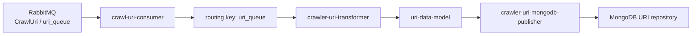
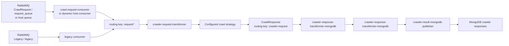
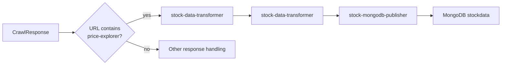
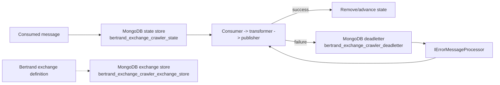

# `Crawler-Exchange`

Factory: [`Crawler.Management.Service/BertrandExchangeFactory.cs`](/home/user/src/chomsky-engine-pri/Crawler.Management.Service/BertrandExchangeFactory.cs)

## Purpose

`Crawler-Exchange` is the Management Service's orchestration exchange. It consumes
crawl URIs and crawl requests from RabbitMQ, executes the configured crawl
strategy, converts crawl responses into persistence models, and routes results to MongoDB. It is created and started by
[`Crawler.Management.Service/Worker.cs`](/home/user/src/chomsky-engine-pri/Crawler.Management.Service/Worker.cs).

Before creating the exchange, the worker bootstraps RabbitMQ. The factory also
replays messages recorded in the Bertrand state repository through
`IErrorMessageProcessor`.

## Dependencies

| Dependency | Why it is injected or created |
| --- | --- |
| MongoDB repository factory | Creates crawler state, dead-letter, exchange-store, crawl-response, URI, and stock-data repositories |
| `IAmqpProvider` / `IAmqpBootstrapper` | Creates RabbitMQ consumers and dynamic host queues |
| `IJsonConverterProvider` | Reads `RequestRepository/crawl_requests/crawl_requests.json` and serializes Bertrand state |
| `ISchedulerRepository` | URI de-duplication and scheduler persistence |
| `IConfigurationRepository` | Synchronizes dynamic crawl configuration and determines URI skip rules |
| `ICrawlStrategyMapper` | Resolves the crawl and continuation strategies used by `CrawlRequestTransformer` |
| `ICrawlerResponseShardedRepository` | Stores crawler responses and URI-linked response data |
| `IErrorMessageProcessor` | Reprocesses persisted Bertrand failures before startup |
| Prometheus metrics and logging | Transformer, exchange, and worker telemetry |

Bertrand persistence uses these MongoDB collections:

| Purpose | Collection |
| --- | --- |
| In-flight exchange messages | `bertrand_exchange_crawler_state` |
| Dead-letter messages | `bertrand_exchange_crawler_deadletter` |
| Exchange definition and component state | `bertrand_exchange_crawler_exchange_store` |

## Consumers

| Name / source | Type | Routing behavior |
| --- | --- | --- |
| `crawl-uri-consumer` | `RabbitMqBertrandConsumer<CrawlUri>` | Reads the `CrawlUri` context, normally `uri_queue` |
| `crawl-request-consumer` | `RabbitMqBertrandConsumer<CrawlRequest>` | Reads `CrawlRequest` / `request_queue` |
| `legacy` | `RabbitMqBertrandConsumer<CrawlRequest>` | Reads the `Legacy` context and queue `legacy`; bypasses with `request*` |
| `<host>_consumer` | Dynamically created RabbitMQ consumers | One consumer is created for every request in `RequestRepository/crawl_requests/crawl_requests.json` with `ShouldDynamicBootstrap`; a queue named after the host is created on exchange `crawler` |

Dynamic request configuration is synchronized through
`IConfigurationRepository.AddOrUpdate` before each dynamic consumer is added.

## Transformers

| Name | Input | Output routing key | Behavior |
| --- | --- | --- | --- |
| `crawler-uri-transformer` | `CrawlUri` | `uri-data-model` | Normalizes the URI, checks response and scheduler duplicates, applies skip rules, and emits a `UriDataModel` |
| `crawler-request-transformer` | `CrawlRequest` | `crawler-request` | Resolves crawl strategies, runs the crawl, and emits `CrawlResponse` |
| `crawler-response-transformer-mongodb` | `CrawlResponse` | `crawler-response-transformer-mongodb` | Maps the response to `CrawlResponseModel` for MongoDB |
| `stock-data-transformer` | `CrawlResponse` | Transformer-defined stock-data route | Selects stock market data from matching crawl responses and maps it to `StockDataResponseModel` |

`CrawlRequestTransformer` increments crawl metrics for started, completed, and
failed crawls. `UriTransformer` records duplicate, skipped, and newly stored URI
metrics.

## Publishers

| Name | Endpoint | Target |
| --- | --- | --- |
| `crawler-uri-mongodb-publisher` | `MongoDbPublisher<UriDataModel>` | URI data repository configured by `UriDataConfiguration` |
| `crawler-result-mongodb-publisher` | `MongoDbPublisher<CrawlResponseModel>` | `ICrawlerResponseShardedRepository` |
| `stock-mongodb-publisher` | `MongoDbPublisher<StockDataResponseModel>` | MongoDB collection `stockdata` |

Publishers are Bertrand wrappers: they cast the generic message payload to the
publisher's concrete type before invoking the endpoint publisher.

## Filters and routing

### Consumer to transformer filters

| Incoming routing key | Target transformer |
| --- | --- |
| `uri_queue` | `crawler-uri-transformer` |
| `request*` | `crawler-request-transformer` |
| `crawler-request` | `crawler-response-transformer-mongodb` |
| URL contains `live-markets/market-data-dashboard/price-explorer` | `stock-data-transformer` |

### Transformer to publisher filters

| Transformer routing key | Target publisher |
| --- | --- |
| `uri-data-model` | `crawler-uri-mongodb-publisher` |
| `crawler-response-transformer-mongodb` | `crawler-result-mongodb-publisher` |
| `stock-data-transformer` | `stock-mongodb-publisher` |

## Data flows

## Failure and recovery flow

