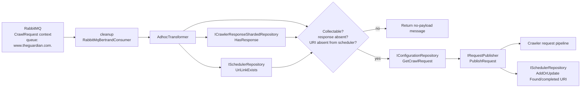
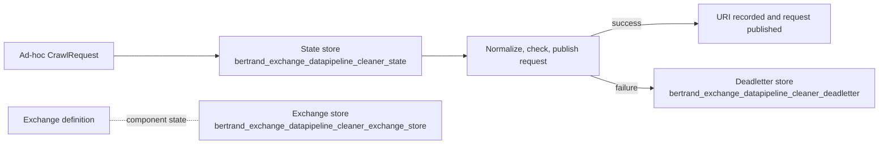

# `Data-Pipeline-Adhoc-Exchange`

Factory: [`Crawler.Data/Crawler.Data.Service/BertrandAdhocExchangeFactory.cs`](/home/user/src/chomsky-engine-pri/Crawler.Data/Crawler.Data.Service/BertrandAdhocExchangeFactory.cs)

## Purpose

`Data-Pipeline-Adhoc-Exchange` consumes ad-hoc crawl requests for
`www.theguardian.com`. Its transformer applies duplicate and collectability
checks, publishes an eligible crawl request through `IRequestPublisher`, and
records the URI as completed in the scheduler repository.

The factory constructs the exchange, but the current Data Service worker does
not start it: the `Start()` and `End()` calls for the adhoc exchange are
commented out.

## Dependencies

| Dependency | Use |
| --- | --- |
| MongoDB repository factory | Creates Bertrand state, dead-letter, and exchange stores |
| `IJsonConverterProvider` | Persists and restores Bertrand messages |
| `ILoggerFactory` | Exchange, transformer, and manager logging |
| `IConfiguration` | MongoDB collection configuration |
| `IConfigurationRepository` | Checks whether a URI is collectable and loads its crawl request |
| `ISchedulerRepository` | Checks existing URI links and records the new URI |
| `ICrawlerResponseShardedRepository` | Checks whether a response already exists |
| `IAmqpProvider` / `IAmqpBootstrapper` | Injected for AMQP integration; this factory does not create a Bertrand publisher or queue |
| `IRequestPublisher` | Publishes the generated crawl request to the crawler request pipeline |

Bertrand state collections:

| Purpose | Collection |
| --- | --- |
| In-flight messages | `bertrand_exchange_datapipeline_cleaner_state` |
| Dead-letter messages | `bertrand_exchange_datapipeline_cleaner_deadletter` |
| Exchange definition and component state | `bertrand_exchange_datapipeline_cleaner_exchange_store` |

The collection names are shared with the cleaner factory, so deployments should
treat the two factories as sharing Bertrand persistence state.

## Consumer

| Setting | Value |
| --- | --- |
| Type | `RabbitMqBertrandConsumer<CrawlRequest>` |
| Name | `cleanup` |
| Context | `CrawlRequest` |
| Queue | `www.theguardian.com.` |

The consumer reads from the `CrawlRequest` AMQP context using the configured
RabbitMQ provider.

## Transformer

`AdhocTransformer<CrawlRequest>`:

1. Extracts and normalizes the page URI.
2. Returns a no-payload message when the URI is not collectable, already has a response, or already exists in the scheduler.
3. Loads the configured crawl request for a new URI.
4. Publishes a new request through `IRequestPublisher`.
5. Records the URI as a completed `Found` URI in `ISchedulerRepository`.

There is no Bertrand publisher list. `IRequestPublisher` is a side effect inside
the transformer, so the successful output is the request-pipeline publication
rather than a Bertrand `IPublisher<object>` edge.

## Data flow

## Failure and lifecycle flow

