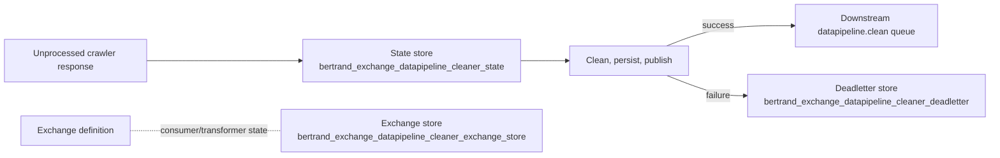

# `Data-Pipeline-Cleaner-Exchange`

Factory: [`Crawler.Data/Crawler.Data.Service/BertrandCleanerExchangeFactory.cs`](/home/user/src/chomsky-engine-pri/Crawler.Data/Crawler.Data.Service/BertrandCleanerExchangeFactory.cs)

## Purpose

`Data-Pipeline-Cleaner-Exchange` reads crawler responses that have not yet been
updated by the data pipeline, cleans them, stores cleaned text, and publishes
`DataPipelineCleanText` messages to the worker queue. The Data Service worker
creates and starts this exchange.

## Dependencies

| Dependency | Use |
| --- | --- |
| MongoDB repository factory | Creates one crawler-response repository per source collection and Bertrand state repositories |
| `ICrawlerResponseShardedRepository` | Reads source response data for the transformer |
| `ICleanTextShardedRepository` | Stores cleaned text |
| `IConfigurationRepository` | Supplies crawler/configuration data to the cleaner |
| `IAmqpProvider` | Obtains the `DatapipelineCleanData` publisher and context |
| `IAmqpBootstrapper` | Creates the cleaned-data queue binding |
| `IJsonConverterProvider` | Persists and restores Bertrand state |
| `ILoggerFactory` | Consumer, transformer, exchange, and manager logging |

Bertrand state collections:

| Purpose | Collection |
| --- | --- |
| In-flight messages | `bertrand_exchange_datapipeline_cleaner_state` |
| Dead-letter messages | `bertrand_exchange_datapipeline_cleaner_deadletter` |
| Exchange definition and component state | `bertrand_exchange_datapipeline_cleaner_exchange_store` |

## Consumers

Ten `MongoDbBertrandBatchConsumer<CrawlResponseModel>` instances are created.
They share the name `mongo-crawler-response-consumer`, batch size `100`, and
routing key `mongo-crawler-response-route`. Each reads documents where
`DataPipelineUpdated` is `null`.

| Source collection |
| --- |
| `crawler_responses_www.theguardian.com` |
| `crawler_responses_www.cdc.gov` |
| `crawler_responses_www.amnesty.org` |
| `crawler_responses_chomsky.info` |
| `crawler_responses_www.medialens.org` |
| `crawler_responses_press.un.org` |
| `crawler_responses_main.un.org` |
| `crawler_responses_undocs.org` |
| `crawler_responses_www.undocs.org` |
| `crawler_responses_docs.un.org` |

## Transformer

`CrawlerResponseCleanerTransformer<CrawlResponseModel>` receives each batch
message and uses:

- `ICrawlerResponseShardedRepository` to read the crawler response;
- `ICleanTextShardedRepository` to write cleaned text;
- `IConfigurationRepository` for crawler configuration;
- `RabbitMqPublisher<DataPipelineCleanText>` as its downstream publisher.

The factory supplies no Bertrand transformer filters or publisher filters.
Consequently, the cleaner transformer is the only transformer and the RabbitMQ
publisher is the configured downstream target.

## Publisher

| Name/context | Target |
| --- | --- |
| `DatapipelineCleanData` | RabbitMQ context configured for exchange `crawler`, queue `datapipeline.clean`, routing key `*` |

The factory explicitly creates the queue before constructing the publisher.

## Data flow

```mermaid
flowchart LR
    subgraph Sources["MongoDB response collections"]
        A["crawler_responses_www.theguardian.com"]
        B["crawler_responses_www.cdc.gov"]
        C["crawler_responses_www.amnesty.org"]
        D["crawler_responses_chomsky.info"]
        E["other configured source collections"]
    end
    Sources --> Consumer["10 MongoDbBertrandBatchConsumer instances<br/>filter: DataPipelineUpdated == null<br/>batch: 100"]
    Consumer --> Route["mongo-crawler-response-route"]
    Route --> Cleaner["CrawlerResponseCleanerTransformer"]
    Cleaner --> CleanStore["ICleanTextShardedRepository"]
    Cleaner --> RabbitPublisher["RabbitMqPublisher<DataPipelineCleanText>"]
    RabbitPublisher --> Rabbit["RabbitMQ<br/>exchange: crawler<br/>queue: datapipeline.clean<br/>routing key: *"]
    Cleaner --> ResponseStore["ICrawlerResponseShardedRepository"]
```

## Failure and lifecycle flow

## Runtime note

[`Crawler.Data/Crawler.Data.Service/Worker.cs`](/home/user/src/chomsky-engine-pri/Crawler.Data/Crawler.Data.Service/Worker.cs)
starts this cleaner exchange and waits on it. The same worker constructs the
adhoc exchange, but its `Start()` and `End()` calls are currently commented out.

