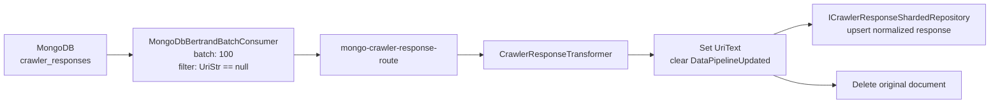
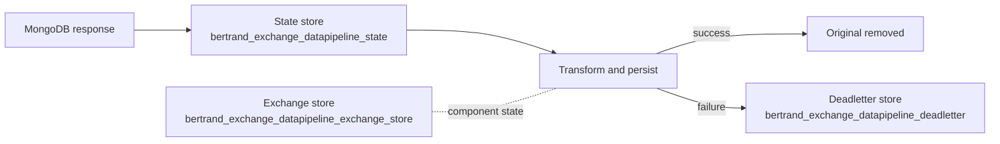

# `Data-Pipeline-Exchange`

Factory: [`Crawler.Data/Crawler.Data.Service/BertrandExchangeFactory.cs`](/home/user/src/chomsky-engine-pri/Crawler.Data/Crawler.Data.Service/BertrandExchangeFactory.cs)

## Purpose

`Data-Pipeline-Exchange` consumes unprocessed crawler responses from the
`crawler_responses` MongoDB collection and normalizes them into the sharded
crawler-response repository. It is a one-consumer, one-transformer exchange with
no Bertrand publishers: persistence is performed by the transformer itself.

The factory is available as `IBertrandExchangeFactory`. In the current Data
Service worker, the keyed cleaner factory is started instead; this factory is
not selected by that worker.

## Dependencies

| Dependency | Use |
| --- | --- |
| `ICrawlerResponseShardedRepository` | Writes normalized responses |
| MongoDB repository factory | Reads `crawler_responses` and creates Bertrand persistence repositories |
| `IJsonConverterProvider` | Serializes and restores in-flight/dead-letter messages |
| `ILoggerFactory` | Exchange, consumer, transformer, and manager logging |
| `IConfiguration` | MongoDB database and collection configuration |

Bertrand state collections:

| Purpose | Collection |
| --- | --- |
| In-flight messages | `bertrand_exchange_datapipeline_state` |
| Dead-letter messages | `bertrand_exchange_datapipeline_deadletter` |
| Exchange definition and component state | `bertrand_exchange_datapipeline_exchange_store` |

## Consumer

`MongoDbBertrandBatchConsumer<CrawlResponseModel>` is configured as:

| Setting | Value |
| --- | --- |
| Name | `mongo-crawler-response-consumer` |
| Source collection | `crawler_responses` |
| Batch size | `100` |
| Query | `UriStr == null` |
| Output routing key | `mongo-crawler-response-route` |

## Transformer

`CrawlerResponseTransformer<CrawlResponseModel>`:

1. Rejects an empty message or payload.
2. Drops messages with no URI.
3. Copies the URI into `UriText`.
4. Clears `DataPipelineUpdated` so the normalized document is eligible for later processing.
5. Writes the response to `ICrawlerResponseShardedRepository`.
6. Deletes the original document from the default repository.
7. Returns the message with routing key `crawler-response-transformer`.

No `IPublisher<object>` instances are registered. The transformer is the data
sink and the only successful output path.

## Data flow

## Failure and lifecycle flow

