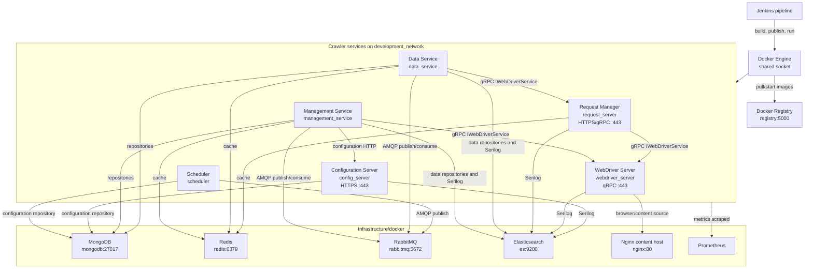
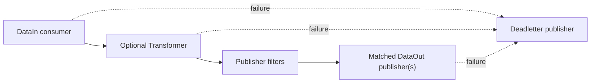
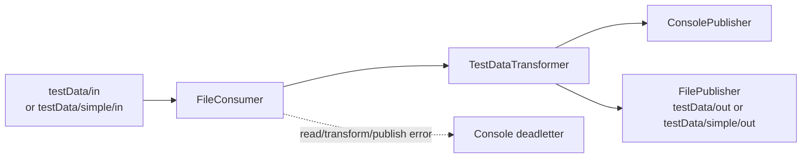
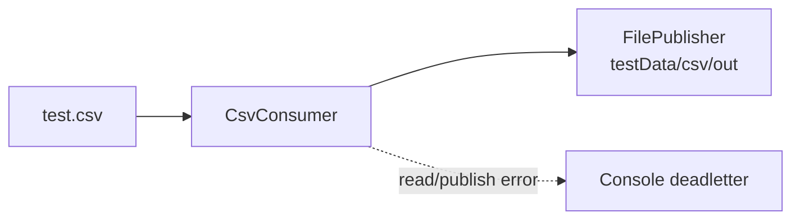
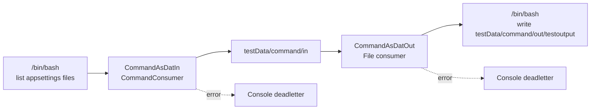
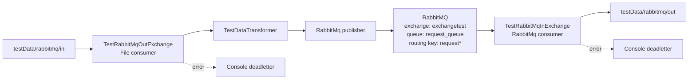
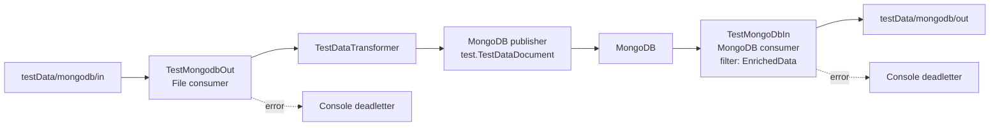
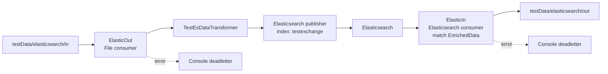
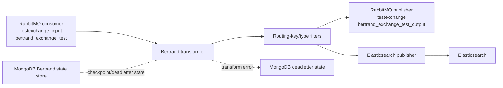

# Chomsky Engine Components and Data Flows

This document describes the production crawler topology started by
[`Jenkinsfile`](/home/user/src/chomsky-engine-pri/Jenkinsfile), the infrastructure
containers started from `Infrastructure/docker`, and the message-exchange flows
defined under `Microservice.Exchange`.

Detailed Bertrand exchange documentation:

- [`Crawler-Exchange`](/home/user/src/chomsky-engine-pri/Documentation/Exchanges/crawler-exchange.md)
- [`Data-Pipeline-Exchange`](/home/user/src/chomsky-engine-pri/Documentation/Exchanges/data-pipeline-exchange.md)
- [`Data-Pipeline-Cleaner-Exchange`](/home/user/src/chomsky-engine-pri/Documentation/Exchanges/data-pipeline-cleaner-exchange.md)
- [`Data-Pipeline-Adhoc-Exchange`](/home/user/src/chomsky-engine-pri/Documentation/Exchanges/data-pipeline-adhoc-exchange.md)
- [`MongoDB use cases`](/home/user/src/chomsky-engine-pri/Documentation/mongodb-use-cases.md)

The component view follows the current Jenkins pipeline. `Crawler.Configuration`
is shown because the running services reference `config_server`, although the
current Jenkins start stage does not start that container.

## Component diagram

### Components

| Component | Started by Jenkins | Injected or configured dependencies | Primary role |
| --- | --- | --- | --- |
| Request Manager | Yes (`request_server`) | Redis; WebDriver gRPC client; Elasticsearch logging | Receives HTTPS/gRPC crawl requests and coordinates request execution |
| WebDriver Server | Yes (`webdriver_server`) | Firefox/WebDriver implementation; Elasticsearch logging | Downloads and renders target pages through the gRPC API |
| Management Service | Yes (`management_service`) | MongoDB repositories; Redis cache; RabbitMQ; Elasticsearch repository/logging; WebDriver gRPC client | Manages crawl requests, configuration, publishing, and dead-letter handling |
| Scheduler | Yes (`scheduler`) | MongoDB repositories; RabbitMQ publisher; configuration repository | Creates scheduled and URI crawl work |
| Data Service | Yes (`data_service`) | MongoDB repositories; Redis cache; RabbitMQ; Elasticsearch repositories/logging; Request Manager gRPC client | Consumes crawl work and persists/cleans crawl data |
| Configuration Server | Not in current Jenkins start stage | MongoDB repositories; Elasticsearch logging | Serves crawler configuration over HTTPS |
| MongoDB | Infrastructure script | Persistent `/home/user/docker/volumes/mongodb` volume | Crawler requests, schedules, configuration, and document data |
| Redis | Infrastructure script | Persistent `/home/user/docker/volumes/redis` volume | Shared crawler cache |
| RabbitMQ | Infrastructure script | `crawler` virtual host; port 5672 | Crawl request, URI, response, legacy, and clean-data messages |
| Elasticsearch | Infrastructure script | Persistent `/home/user/docker/volumes/es` volume | Search/data repository and centralized Serilog sink |
| Docker Registry | Infrastructure script | Persistent registry volume | Stores the images built by Jenkins |

## Exchange processing model

Every Exchange flow has the same logical middle section:

The flow diagrams below show the concrete endpoint combinations configured in
`Microservice.Exchange/Microservice.Exchange.Test` and the Bertrand integration
tests. Dead-letter output is omitted from the success path and shown as a
dashed error edge.

## Flow 1: File to console and file

Configured by `appsettings.Development.json` and `appsettings.Simple.json`.

## Flow 2: CSV to JSON file

Configured by `appsettings.Csv.json`.

## Flow 3: Command to file, then file to command

Configured by `appsettings.Development.Command.json`.

## Flow 4: File to RabbitMQ and RabbitMQ to file

Configured by `appsettings.Development.Rabbitmq.json`.

## Flow 5: File to MongoDB and MongoDB to file

Configured by `appsettings.Development.Mongodb.json`.

## Flow 6: File to Elasticsearch and Elasticsearch to file

Configured by `appsettings.Development.Elasticsearch.json`.

## Flow 7: Bertrand RabbitMQ to Elasticsearch with MongoDB state

The Bertrand integration tests compose a RabbitMQ consumer, transformer, routing
filters, and Elasticsearch publisher. MongoDB stores exchange and dead-letter
state so processing can resume after failures.

## Flow summary

| Flow | Input | Transformer | Output | Error handling |
| --- | --- | --- | --- | --- |
| File to console/file | File directory | `TestDataTransformer` | Console and file | Console deadletter |
| CSV to JSON file | `test.csv` | None | JSON file directory | Console deadletter |
| Command round trip | Shell command, then file | None | File, then shell command | Console deadletter per exchange |
| RabbitMQ round trip | File, then RabbitMQ | `TestDataTransformer` on outbound leg | RabbitMQ, then file | Console deadletter per exchange |
| MongoDB round trip | File, then MongoDB | `TestDataTransformer` on outbound leg | MongoDB, then file | Console deadletter per exchange |
| Elasticsearch round trip | File, then Elasticsearch | `TestEsDataTransformer` on outbound leg | Elasticsearch, then file | Console deadletter per exchange |
| Bertrand RabbitMQ to Elasticsearch | RabbitMQ | Bertrand transformer and filters | RabbitMQ and Elasticsearch | MongoDB state/deadletter store |
