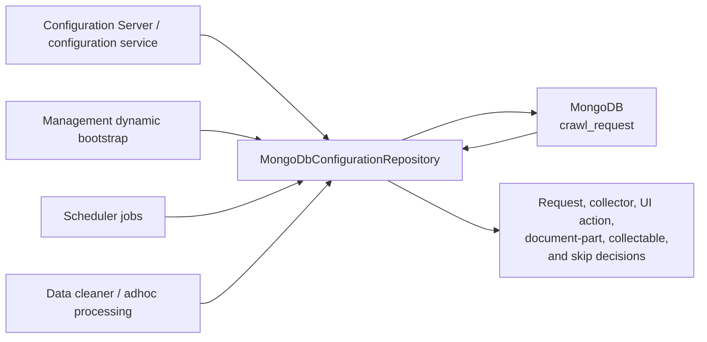
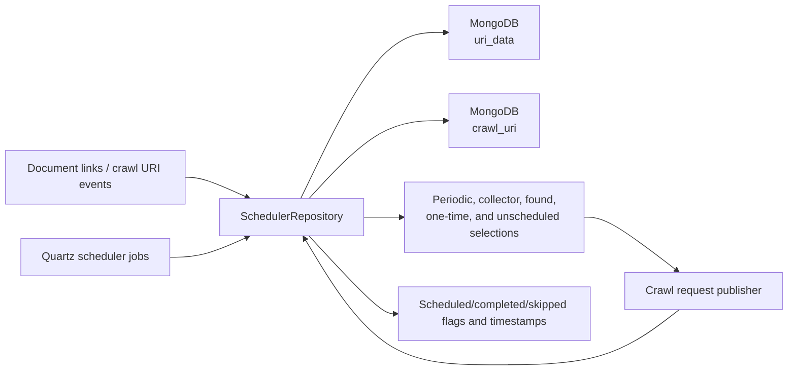
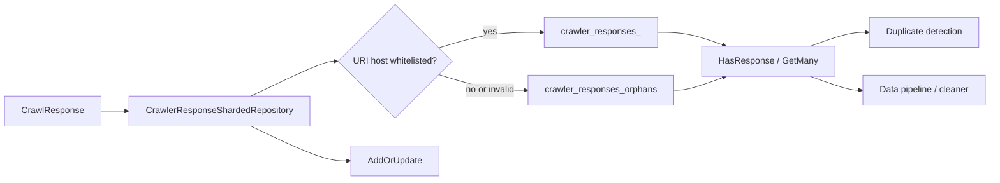
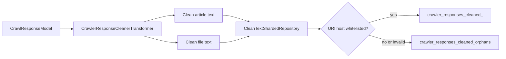
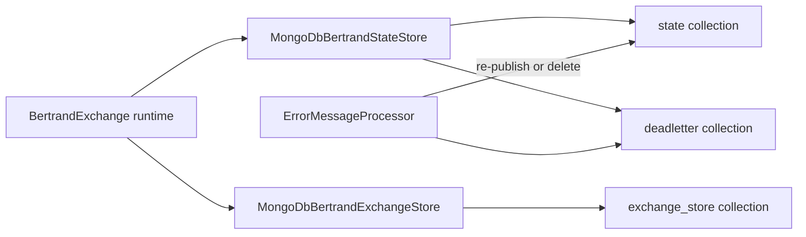
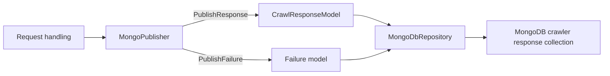
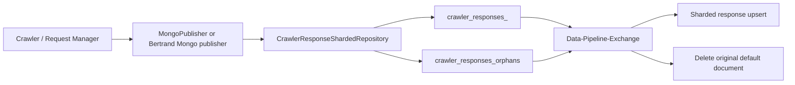
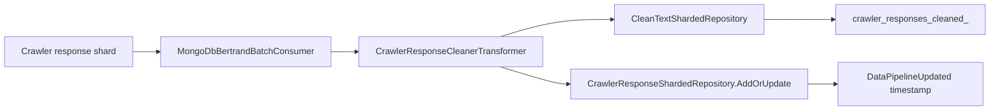
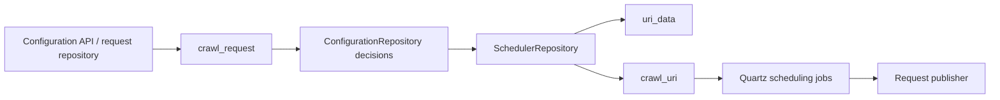

# MongoDB Use Cases

This document covers production MongoDB repository usage in the crawler. It
excludes `Microservice.Exchange/Microservice.Exchange.Test` and the other test
projects. The repository abstraction serializes `IDataModel` values to BSON and
uses the configured `MongoDbConnectionString`; the default is
`mongodb://mongodb:27017`.

## Repository layers

| Repository surface | Collections / data | Main CRUD owners |
| --- | --- | --- |
| `MongoDbRepository<T>` | Any configured `IDataModel` collection | All higher-level repositories and Mongo publishers |
| `MongoDbConfigurationRepository` | `crawl_request` | Configuration Server, Management Service, Scheduler/Data configuration lookups |
| `SchedulerRepository` | `crawl_uri`, `uri_data` | Scheduler jobs, crawler configuration service, Management/Data transformers |
| `CrawlerResponseShardedRepository` | `crawler_responses_<host>` and `crawler_responses_orphans` | Management response publishers/transformers, Data pipeline and cleaner |
| `CleanTextShardedRepository` | `crawler_responses_cleaned_<host>` and `crawler_responses_cleaned_orphans` | Data cleaner transformer |
| `MongoDbBertrandStateStore` | Bertrand state and dead-letter collections | Runtime Bertrand exchange processing and Management dead-letter worker |
| `MongoDbBertrandExchangeStore` | Bertrand exchange-store collections | Runtime Bertrand exchange lifecycle |
| `MongoPublisher` | Crawl response/failure collections | Request-handling response and failure publishers |
| MongoDB Exchange endpoints | Configured endpoint collections | Runtime `MongodbConsumer`, `MongoDbBertrandBatchConsumer`, and `MongodbPublisher`; test-only configurations are not covered here |

`RepositoryFactory.CreateRepositoryAsync` creates the collection if it does not
exist before returning a repository. Services therefore normally do not need a
separate schema-initialization step.

## Generic `MongoDbRepository<T>`

Implementation:
[`MongoDbRepository.cs`](/home/user/src/chomsky-engine-pri/Microservice.Mongodb/Microservice.Mongodb.Repo/MongoDbRepository.cs)

### CRUD contract

| Operation | Method | Behavior |
| --- | --- | --- |
| Create collection | `EnsureCollectionExists()` | Lists collections and creates the configured collection when missing |
| Create | `AddOrUpdate(document)` with empty `Id` | Assigns a new GUID, sets `Created`, and calls `InsertOneAsync` |
| Update | `AddOrUpdate(document)` with existing `Id` found | Sets `Updated` and replaces the matching document |
| Upsert | `AddOrUpdate(document)` with existing `Id` not found | Inserts the supplied ID as a new document |
| Read one | `Get(id)` or `Get(filter)` | Returns the first matching deserialized model |
| Read many | `GetMany(filter, limit, skip)` | Returns a bounded list |
| Stream | `GetBatches(filter, cancellationToken, batchSize)` | Streams cursor batches for recovery and bulk processing |
| Delete one | `Delete(id)` | Deletes by serialized `IDataModel.Id` |
| Delete many | `Delete(filter)` | Deletes every matching document |

All callers use this same CRUD behavior; higher-level repositories add routing,
filters, and domain semantics rather than changing persistence semantics.

## Configuration repository

Implementation:
[`MongoDbConfigurationRepository.cs`](/home/user/src/chomsky-engine-pri/Crawler.Configuration/Crawler.Configuration.Repository/MongoDbConfigurationRepository.cs)

### Collection

| Database | Collection | Model |
| --- | --- | --- |
| `MongoDbDatabaseName` | `crawl_request` | `CrawlRequestModel` |

### Use cases and CRUD owners

| Use case | CRUD | Caller |
| --- | --- | --- |
| Store or synchronize crawler configuration | Create/update | `Crawler.Management.Service.BertrandExchangeFactory.CreateDynamicConsumers` and configuration APIs |
| Load a request for a URI | Read filtered by host and exact URI or `*` | `CrawlerConfigurationService`, `UriTransformer`, `AdhocTransformer`, `StockCollectionJob`, cleaner |
| Load collector configuration | Read with `IsUrlCollector = true` | `CrawlerConfigurationService` |
| Read UI actions | Read, project `UiActions` | Configuration service/API |
| Read document-part definition | Read, project `DocumentPartDefinition` | Configuration service/API |
| Decide whether a URI is collectable | Read `CollectablePattern`, evaluate regex | `UriTransformer`, `FoundUriJob`, cleaner |
| Decide whether a URI should be skipped | Read `UrlSkipList`, apply whitelist and substring checks | `UriTransformer`, `FoundUriJob`, cleaner |
| Remove all configuration for a URI | Delete by generated URI filter | Configuration management path through `DeleteAll` |

## Scheduler repository

Implementation:
[`SchedulerRepository.cs`](/home/user/src/chomsky-engine-pri/Crawler.Scheduler/Crawler.Scheduler.Repository/SchedulerRepository.cs)

### Collections

| Collection | Model | Meaning |
| --- | --- | --- |
| `crawl_uri` | `CrawlUriDataModel` | A scheduled crawl instance linked to a URI |
| `uri_data` | `UriDataModel` | Discovered, periodic, collector, found, or one-time URI state |

### Use cases and CRUD owners

| Use case | CRUD | Caller |
| --- | --- | --- |
| Add a URI link | Create/update `uri_data` | `CrawlerConfigurationService.StoreDetectedUrls`, `UriTransformer`, adhoc transformer |
| Add a crawl instance | Create/update `crawl_uri` | `FoundUriJob`, configuration service |
| Detect duplicate URI | Read one by `Uri` | `UriTransformer`, adhoc transformer |
| Find periodic URIs | Read many: `UriTypeId = Periodic` and cron present | `CrawlerConfigurationService`, periodic scheduler jobs |
| Find collector URIs | Read many: `UriTypeId = Collector` and cron present | `CrawlerConfigurationService` |
| Find unscheduled crawl instances | Read many: `ScheduledTimestamp = null` | `UnscheduledUriCrawlJob` |
| Find found URIs | Read many: `UriTypeId = Found`, `IsCompleted = false` | `FoundUriJob` |
| Find incomplete one-time URIs | Read many: `UriTypeId = Onetime`, `IsCompleted = false` | `OnetimeUriJob` |
| Find new collector URIs | Read many: collector and no cron, incomplete | Collector scheduling |
| Mark scheduled | Read then update `ScheduledTimestamp` | `UnscheduledUriCrawlJob` |
| Mark completed | Read then update `CompletedTimestamp` | `OnetimeUriJob`, `FoundUriJob`, adhoc processing |
| Load URI by ID | Read one by GUID | `UnscheduledUriCrawlJob`, configuration service |

## Crawler response repository

Implementation:
[`CrawlerResponseShardedRepository.cs`](/home/user/src/chomsky-engine-pri/Crawler.Data/Crawler.Data.Repository/CrawlerResponseShardedRepository.cs)

### Collection routing

Responses are routed by the host in `UriText`:

- whitelisted hosts use `crawler_responses_<host>`;
- non-whitelisted hosts and invalid/missing URIs use `crawler_responses_orphans`;
- repositories are created lazily and cached in a concurrent host-to-repository map.

### Use cases and CRUD owners

| Use case | CRUD | Caller |
| --- | --- | --- |
| Persist crawl response | Create/update selected shard | Management `MongoPublisher`, crawl-response transformer |
| Check whether a URI already has a response | Read one by `UriText` | `UriTransformer`, `AdhocTransformer`, error recovery |
| Query responses | Read many with URI and BSON filters | Data cleaner and data pipeline consumers |
| Mark data pipeline processed | Update `DataPipelineUpdated` | `CrawlerResponseCleanerTransformer` |
| Remove an unnormalized response | Delete through generic repository | `CrawlerResponseTransformer` after sharded upsert |

## Clean-text repository

Implementation:
[`CleanTextShardedRepository.cs`](/home/user/src/chomsky-engine-pri/Crawler.Data/Crawler.Data.Repository/CleanTextShardedRepository.cs)

### Collection routing and CRUD

`DataPipelineCleanText` documents use the same host-based routing strategy as
crawler responses:

| Operation | Owner |
| --- | --- |
| Create/update cleaned article or file text | `CrawlerResponseCleanerTransformer.AddCleanedDataToDatabase` |
| Select host shard | `CleanTextShardedRepository` using `DataPipelineCleanText.Uri` |
| Fallback for non-whitelisted/invalid URI | `crawler_responses_cleaned_orphans` |
| Read/delete | No production caller is defined in this repository surface |

The cleaner also updates the source response's `DataPipelineUpdated` field
through `CrawlerResponseShardedRepository`. The optional RabbitMQ publication
method exists in the transformer, but the current cleaning path does not call
it.

## Bertrand state and exchange repositories

These are runtime repositories used by Bertrand exchanges, not test fixtures.

### State store

Implementation:
[`MongoDbBertrandStateStore.cs`](/home/user/src/chomsky-engine-pri/Microservice.Exchange/Microservice.Exchange.Core/Bertrand/MongoDbBertrandStateStore.cs)

| Operation | CRUD owner | Use |
| --- | --- | --- |
| Store incoming message | Create/update | Persist a message before processing |
| Restore outstanding messages | Batch read | Resume processing after restart |
| Store dead-letter message | Create/update | Persist failed processing |
| Delete processed message | Delete by GUID | Acknowledge successful or recovered processing |

The Management exchange uses `bertrand_exchange_crawler_state` and
`bertrand_exchange_crawler_deadletter`. The Data exchanges use the
`bertrand_exchange_datapipeline_*` state/dead-letter collections; the cleaner
and adhoc factories currently share the `*_cleaner_*` names.

### Exchange store

Implementation:
[`MongoDbBertrandExchangeStore.cs`](/home/user/src/chomsky-engine-pri/Microservice.Exchange/Microservice.Exchange.Core/Bertrand/MongoDbBertrandExchangeStore.cs)

| Operation | CRUD owner | Use |
| --- | --- | --- |
| Save exchange definition | Create/update | `BertrandExchange` startup |
| Read exchange definition | Read by exchange name | Determine component active state |
| Read consumer state | Read projection | Enable/disable a consumer |
| Read transformer state | Read projection | Enable/disable a transformer |
| Read publisher state | Read projection | Enable/disable a publisher |

## Direct Mongo response publisher

Implementation:
[`MongoDbPublisher.cs`](/home/user/src/chomsky-engine-pri/Crawler.Core/Crawler.Management.Core/RequestHandling.Core/MongoDb/MongoDbPublisher.cs)

`MongoPublisher` is the request-handling adapter used when responses or failed
requests must be persisted outside the Bertrand publisher list:

| Method | CRUD | Data |
| --- | --- | --- |
| `PublishResponse` | Create/update | Maps `CrawlResponse` to `CrawlResponseModel` |
| `PublishFailure` | Create/update | Maps failed `CrawlRequest` to the response/failure model |

## Runtime Mongo endpoint use cases

The MongoDB Exchange endpoints are production-capable adapters and are
documented here without their test configurations:

| Adapter | CRUD | Use |
| --- | --- | --- |
| `MongodbPublisher<R>` | Create/update target model; create/update dead-letter model on endpoint errors | Publishes a Bertrand message to a MongoDB collection |
| `MongodbConsumer<T>` | Read many with configured filters | Polls a MongoDB collection and emits messages |
| `MongoDbBertrandBatchConsumer<T>` | Batch read with a BSON filter | Feeds Bertrand transformers from a repository |
| `MongoDbBertrandPollingConsumer<T>` | Read many with limit/skip polling | Feeds Bertrand transformers from a repository |

These adapters are used by runtime exchange factories through repository
factories or domain repositories. No `Microservice.Exchange.Test` flow is
included in this document.

## End-to-end production data flows

### Crawl response ingestion and normalization

### Response cleaning

### Configuration and scheduling

## CRUD ownership summary

| MongoDB data | Create/update | Read | Delete |
| --- | --- | --- | --- |
| `crawl_request` | Configuration API, Management dynamic bootstrap | Configuration service, Management/Data/Scheduler jobs and transformers | Configuration management `DeleteAll` |
| `uri_data` | URI discovery, URI transformer, adhoc/configuration services, scheduler jobs | Scheduler jobs, configuration service, duplicate checks | No domain delete method in `SchedulerRepository` |
| `crawl_uri` | Found URI job, configuration service | Unscheduled/periodic/one-time scheduler jobs | No domain delete method in `SchedulerRepository` |
| `crawler_responses_<host>` | Request handling and Management/data transformers | Duplicate checks, pipeline consumers, error recovery | Data pipeline removes the original default document; no general response delete API |
| `crawler_responses_cleaned_<host>` | Data cleaner | No production read surface in this repository | No production delete surface |
| Bertrand state | Bertrand runtime | Bertrand recovery and error processor | Bertrand acknowledgement/recovery |
| Bertrand dead-letter | Bertrand runtime | Error processor | Error processor after successful recovery or confirmed result |
| Bertrand exchange store | Bertrand runtime startup | Bertrand component activation checks | No delete operation exposed |

